# Lab 3 — Teardown, and the same machine from the command line

Pair: Temirlan Jaxibekov (individual — no lab partner)
Machine (second half): MacBook Pro 13" (Intel Core i5-8257U, 8 GB LPDDR3), macOS · Linux: Ubuntu 22.04 VM on the same Mac (the Linux VM that the Claude desktop app runs with Apple's Virtualization framework)
No Windows machine in the pair, so the table covers macOS and Linux (the brief needs at least two operating systems).
Date: 07.11.2026

## Part 1 — A teardown on paper

Every fact below is taken from the maker's own page (link under each part). Screenshots of those pages are in `evidence/photos/`.

### Processors

**AMD Ryzen 5 7600**
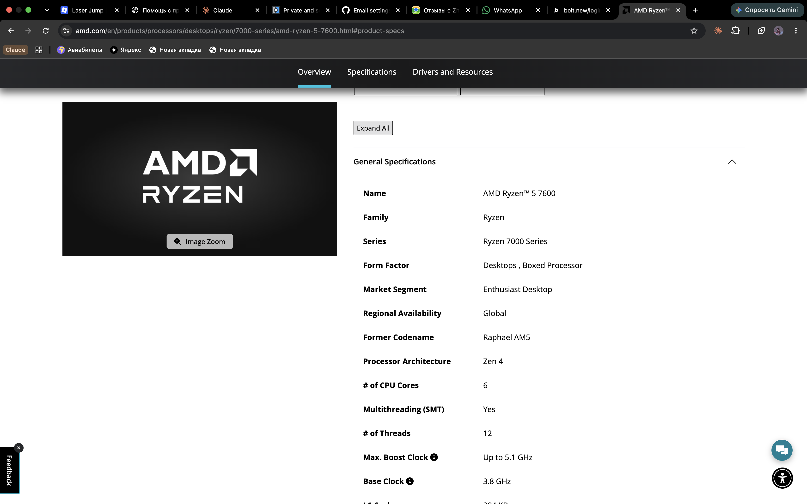
Desktop CPU, 6 cores / 12 threads, 3.8 GHz base, up to 5.1 GHz boost, 32 MB L3, 65 W default TDP, integrated AMD Radeon Graphics (2 cores).
*Connects to:* socket **AM5** motherboards. Talks to DDR5 memory (2 channels) and PCIe 5.0 devices directly.
*Limits:* AM5 + **DDR5 only**; officially DDR5-5200 with 2 DIMMs (DDR5-3600 with 4 DIMMs); the iGPU is only good for display output, not gaming.
Box: ships with the **AMD Wraith Stealth** cooler ("Thermal Solution (PIB)").
Link: https://www.amd.com/en/products/processors/desktops/ryzen/7000-series/amd-ryzen-5-7600.html

**Intel Core i5-13400**
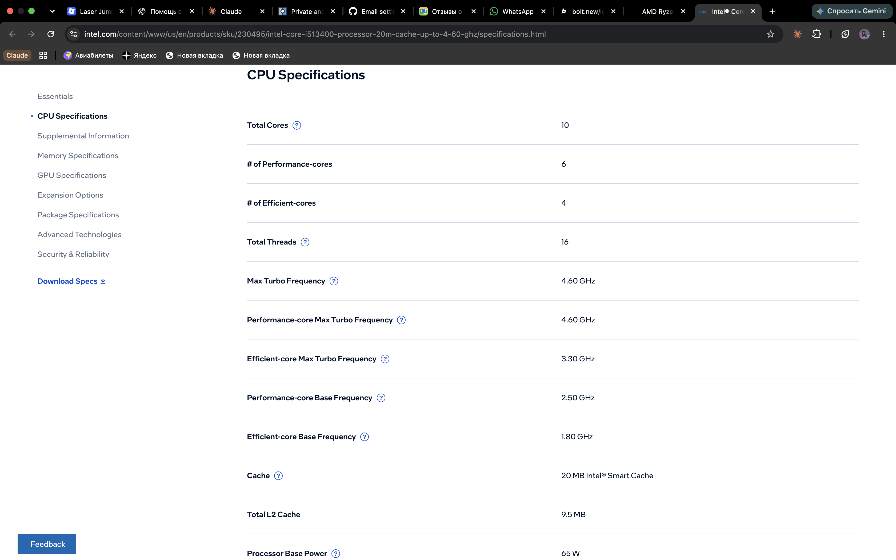
13th-gen desktop CPU, 10 cores (6 Performance + 4 Efficient) / 16 threads, up to 4.6 GHz, 20 MB cache, 65 W base power / 148 W maximum turbo power, Intel UHD Graphics 730.
*Connects to:* socket **LGA1700** motherboards (Intel 600/700-series chipsets). Up to 20 PCIe lanes (PCIe 5.0 and 4.0).
*Limits:* memory up to DDR5-4800 **or** DDR4-3200 — which one is decided by the motherboard, not by the CPU; 148 W peaks need a decent cooler.
Box: the boxed version ships with the **Intel Laminar RM1** cooler (K-models such as the i5-13600K ship without one).
Link: https://www.intel.com/content/www/us/en/products/sku/230495/intel-core-i513400-processor-20m-cache-up-to-4-60-ghz/specifications.html

### Motherboards

**ASUS PRIME B650M-A**
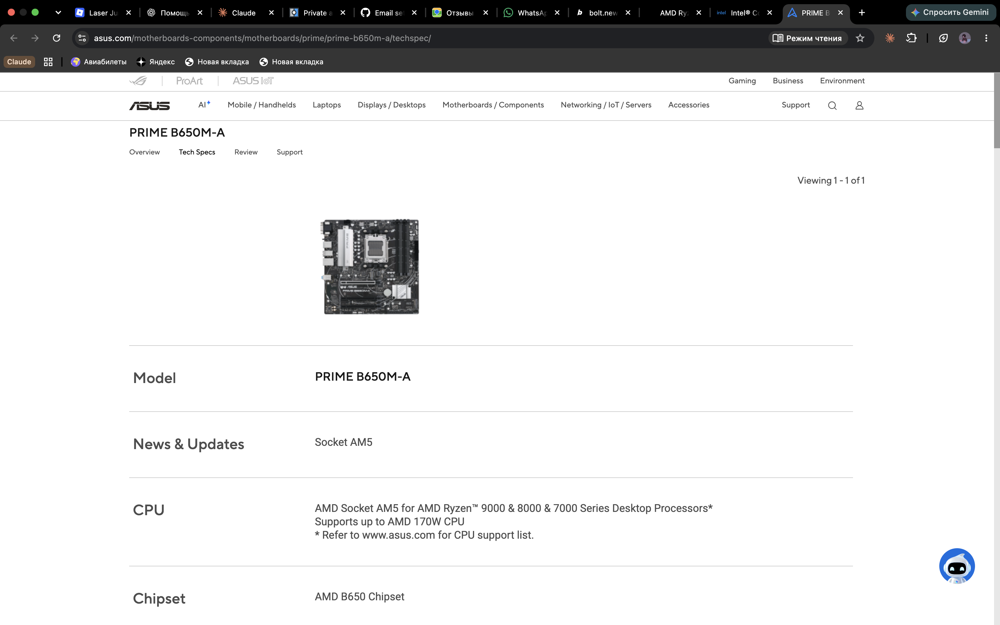
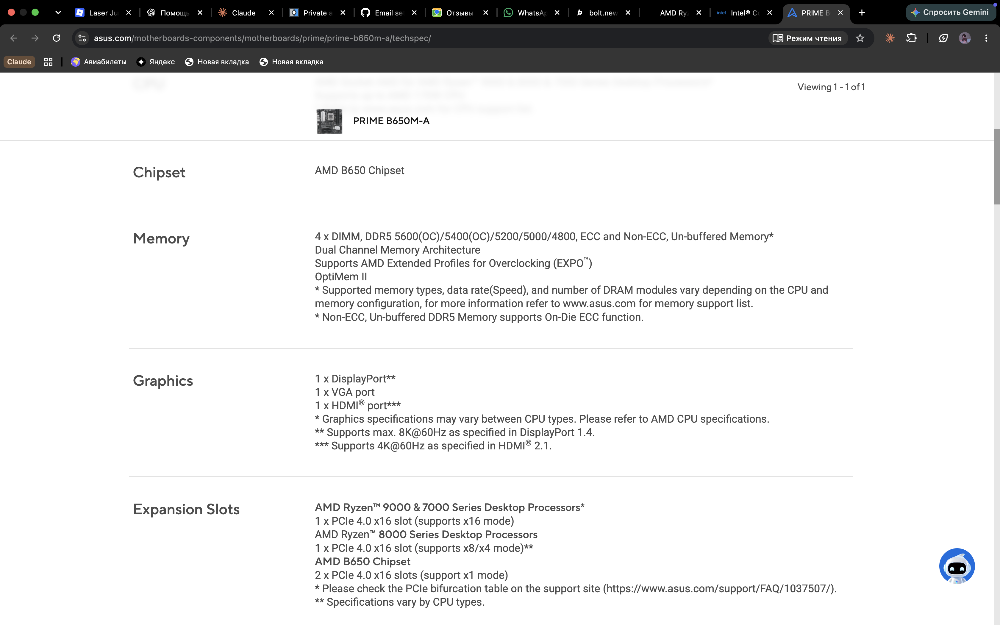
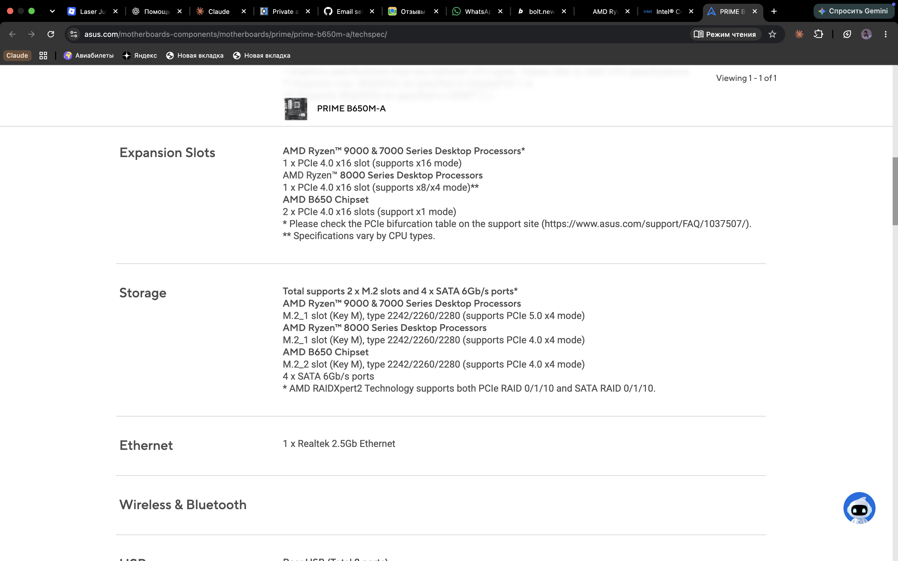
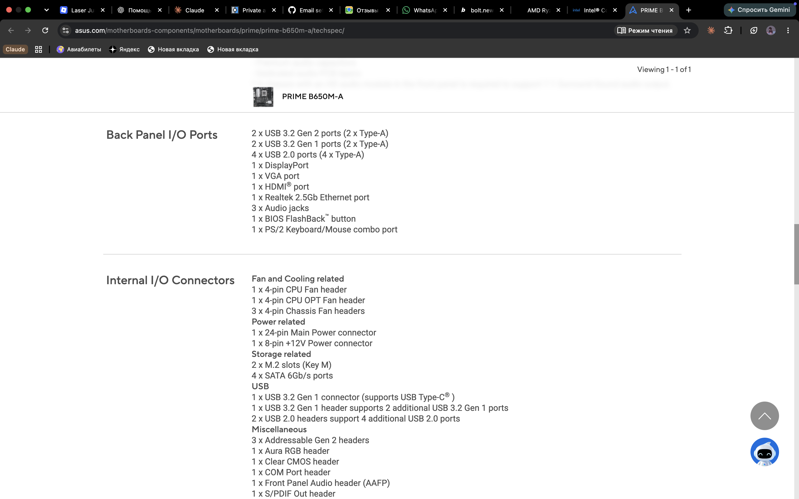
micro-ATX board (24.4 × 24.4 cm). **Socket AM5, chipset AMD B650, memory 4 × DDR5 DIMM** (up to 5600 OC, EXPO).
*CPU generations accepted:* AMD Ryzen **7000, 8000 and 9000** series desktop processors, up to 170 W (see the board's CPU support list).
*Connects:* CPU, DDR5, 2 × M.2 (M.2_1 PCIe 5.0 ×4 with Ryzen 7000/9000), 4 × SATA 6 Gb/s, 24-pin + 8-pin power from the PSU, video out DP / HDMI / VGA for the CPU's iGPU.
*Limits:* AMD only, DDR5 only — a DDR4 stick will not go in.
Link: https://www.asus.com/motherboards-components/motherboards/prime/prime-b650m-a/techspec/

**MSI PRO B760M-A WIFI**
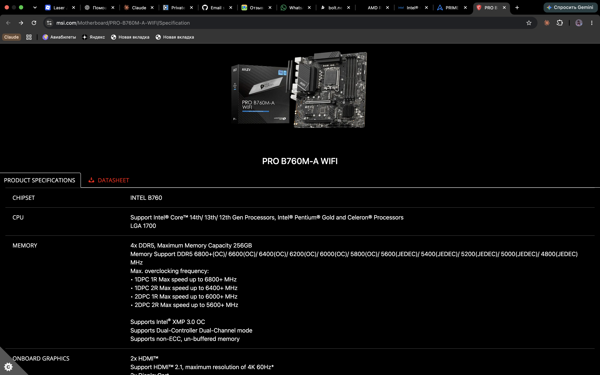
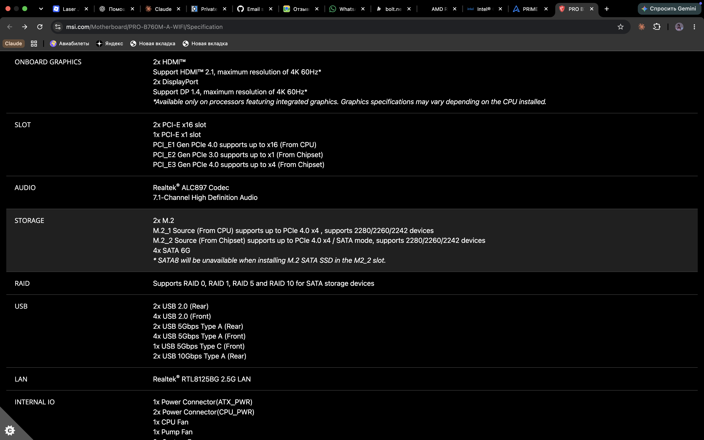
micro-ATX board (24.4 × 24.4 cm). **Socket LGA1700, chipset Intel B760, memory 4 × DDR5** (4800–5600 JEDEC, XMP 3.0, up to 256 GB).
*CPU generations accepted:* Intel Core **12th, 13th and 14th Gen**, Pentium Gold, Celeron.
*Connects:* CPU, DDR5, 2 × M.2 PCIe 4.0 ×4, 4 × SATA 6G, 2 × HDMI + 2 × DisplayPort (only with a CPU that has graphics), Wi-Fi 6E + Bluetooth 5.3, 2.5 G LAN.
*Limits:* Intel only, **DDR5 only**. MSI sells a separate "PRO B760M-A WIFI **DDR4**" board — same name plus "DDR4" — which is the only way to use DDR4 here. B760 does not allow CPU overclocking.
Link: https://www.msi.com/Motherboard/PRO-B760M-A-WIFI/Specification

### Memory

**Kingston FURY Beast DDR5-5600, 16 GB** (KF556C40BB-16)
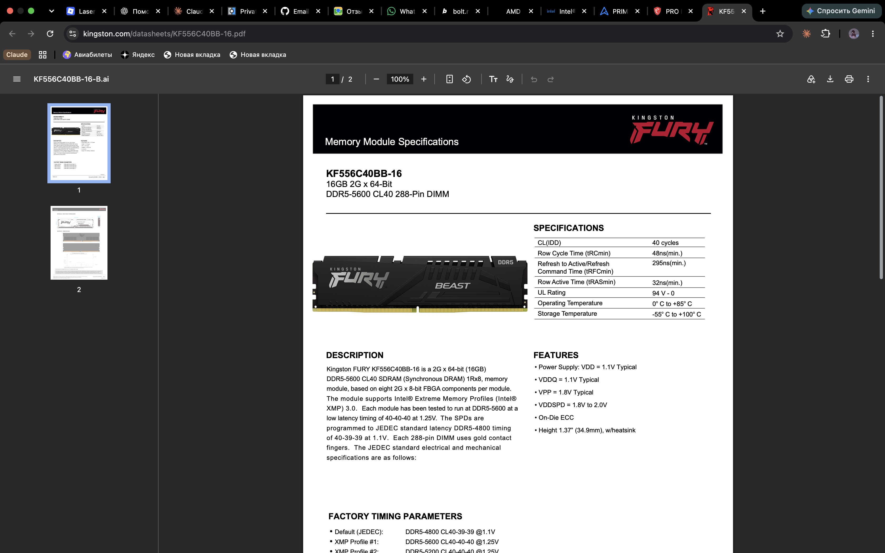
288-pin DDR5 DIMM, 16 GB, single rank. Default (JEDEC) DDR5-4800 CL40 at 1.1 V; **5600 MT/s CL40 at 1.25 V only through its Intel XMP 3.0 profile**.
*Connects to:* a DDR5 DIMM slot on a desktop motherboard.
*Limits:* will not fit a DDR4 board; without XMP enabled in BIOS it runs at 4800, not 5600; the profile is XMP (Intel), not AMD EXPO.
Link: https://www.kingston.com/datasheets/KF556C40BB-16.pdf

**Crucial DDR4-3200, 16 GB UDIMM** (CT16G4DFRA32A)
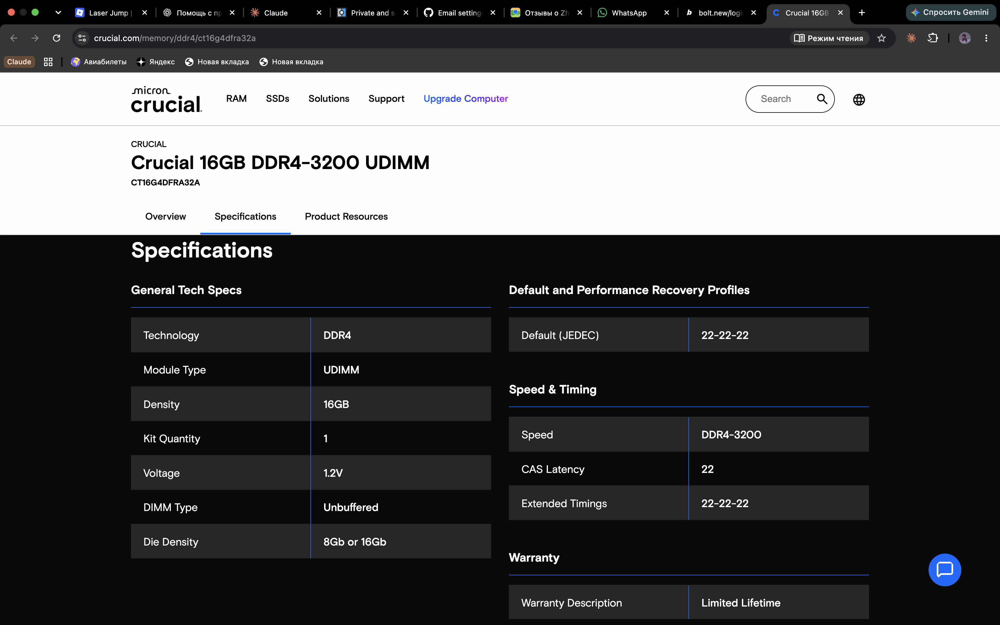
288-pin DDR4 desktop DIMM (unbuffered), 16 GB, 3200 MT/s, CL22, 1.2 V.
*Connects to:* a DDR4 DIMM slot.
*Limits:* the key notch of DDR4 is in a different place than DDR5, so it physically **does not fit either board in this lab** (both are DDR5).
Link: https://www.crucial.com/memory/ddr4/ct16g4dfra32a

### Storage

**Samsung 990 PRO 1 TB**
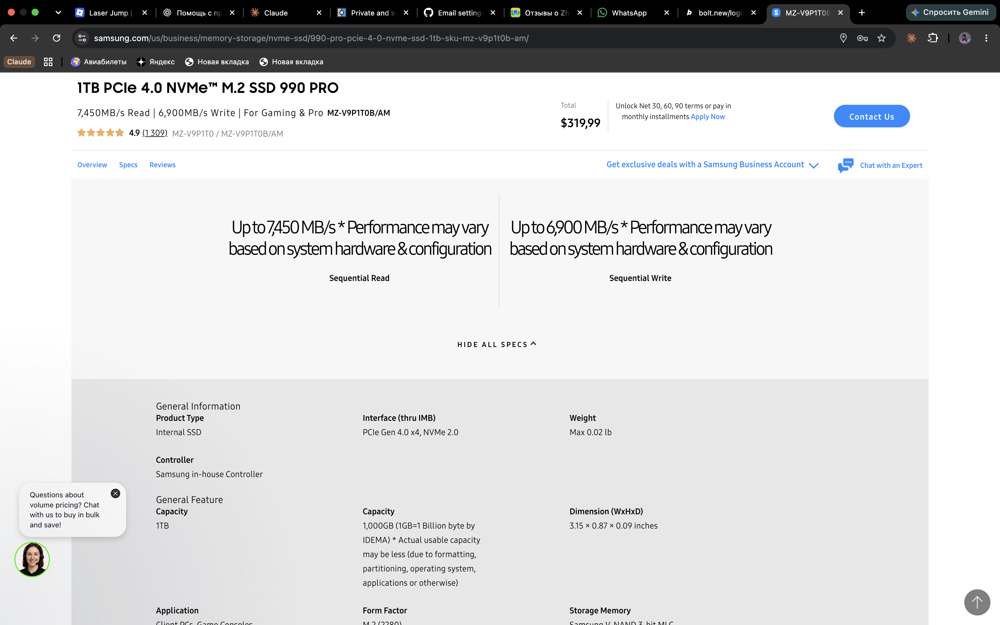
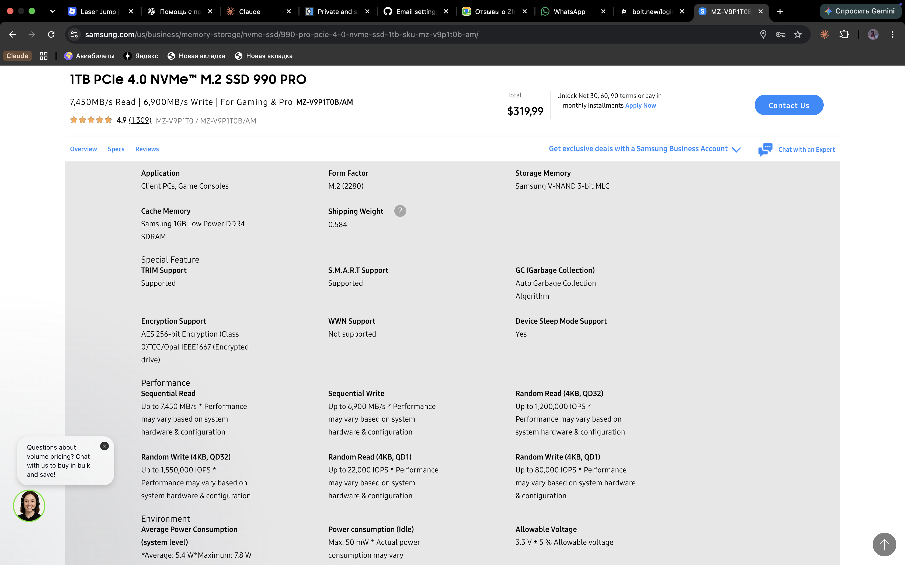
M.2 2280 NVMe SSD, PCIe 4.0, sequential read / write up to 7,450 / 6,900 MB/s.
*Connects to:* an M.2 (Key M) slot on the motherboard — no cables.
*Limits:* PCIe 4.0 ×4; in a PCIe 5.0 slot it still runs at 4.0 speed, in a 3.0 slot at about half.
Link: https://www.samsung.com/us/business/memory-storage/nvme-ssd/990-pro-pcie-4-0-nvme-ssd-1tb-sku-mz-v9p1t0b-am/

**Samsung 870 EVO 1 TB**
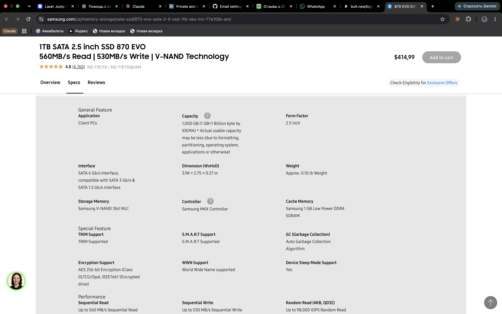
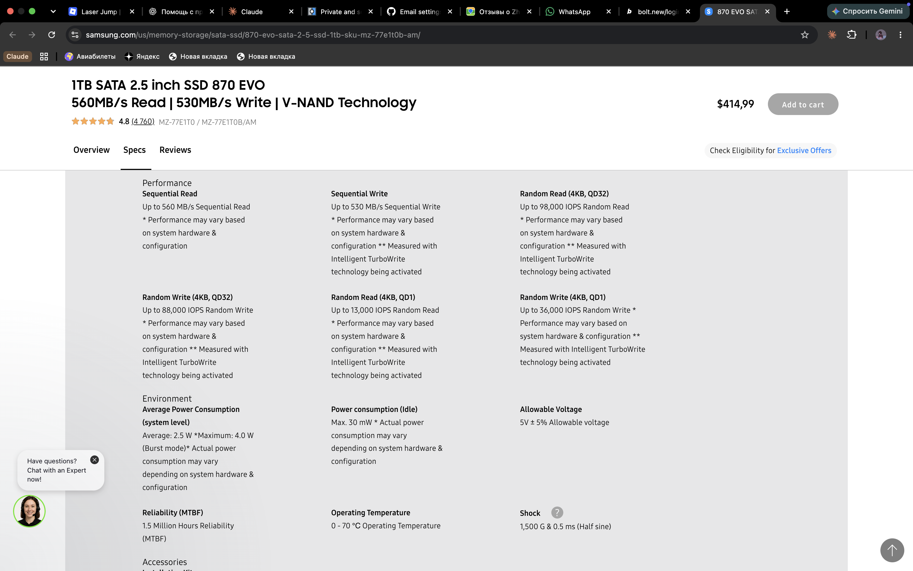
2.5" SATA III SSD, sequential read / write up to 560 / 530 MB/s.
*Connects to:* a SATA port (data cable) + a SATA power connector from the PSU.
*Limits:* the SATA 6 Gb/s interface caps it at ~550 MB/s — about 13× slower than the 990 PRO in sequential reads; needs two cables and a 2.5" bay.
Link: https://www.samsung.com/us/memory-storage/sata-ssd/870-evo-sata-2-5-ssd-1tb-sku-mz-77e1t0b-am/

### Power and cooling

**Corsair RM750e (750 W)** (CP-9020262)
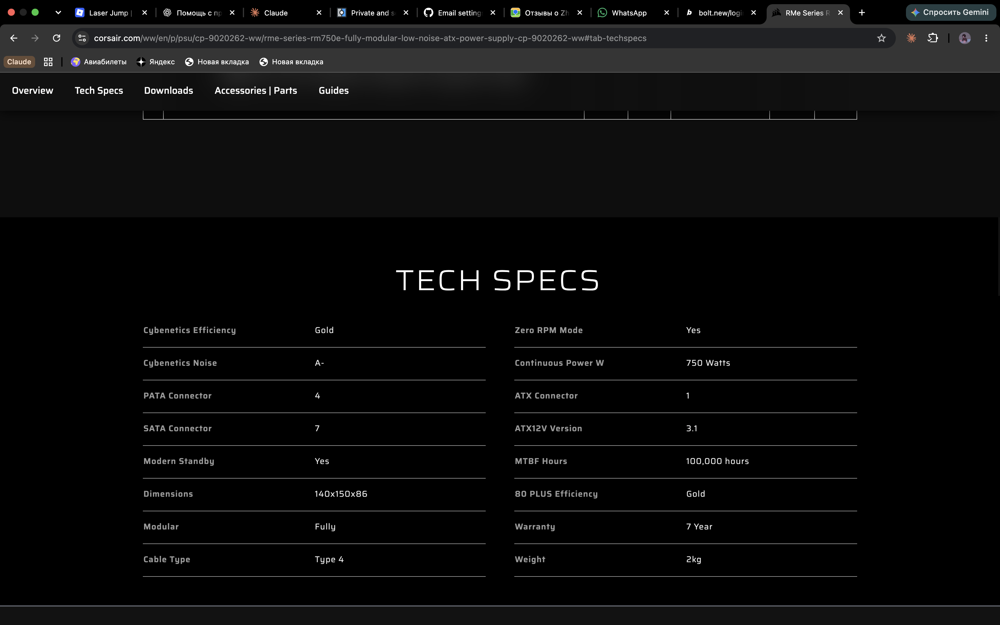
ATX power supply, 750 W continuous, 80 PLUS Gold, fully modular, ATX 3.1, 7-year warranty.
*Connects:* 1 × 24-pin ATX (motherboard), 2 × EPS 8-pin (4+4) (CPU), 1 × 12V-2x6 + 3 × PCIe 8-pin (graphics cards), 7 × SATA power, 4 × Molex.
*Limits:* 750 W total — far more than these two 65 W CPUs need without a graphics card; only **one** PSU for two builds.
Link: https://www.corsair.com/ww/en/p/psu/cp-9020262-ww/rme-series-rm750e-fully-modular-low-noise-atx-power-supply-cp-9020262-ww

**Stock cooler**
Both boxed CPUs come with one: Ryzen 5 7600 → **AMD Wraith Stealth** (on the AMD page); i5-13400 → **Intel Laminar RM1**. The X-versions (Ryzen 5 7600X) and K-versions ship without a cooler.
*Connects to:* the CPU socket's mounting holes + the CPU_FAN header.
*Limits:* sized for ~65 W; under long all-core loads the CPU will run hot and loud.

## The two builds

| | Build A — AMD | Build B — Intel |
|---|---|---|
| CPU | Ryzen 5 7600 | Core i5-13400 |
| Motherboard | ASUS PRIME B650M-A | MSI PRO B760M-A WIFI |
| Why they match | both AM5 | both LGA1700; board lists 13th Gen |
| Memory | **missing** — needs a DDR5 stick | Kingston FURY Beast DDR5-5600 (board is DDR5 and supports its XMP profile) |
| Storage | Samsung 990 PRO (M.2 slot, no cables) | Samsung 870 EVO (SATA port + SATA power) |
| Cooler | Wraith Stealth (in the box) | Laminar RM1 (in the box) |
| PSU | Corsair RM750e | **missing** — needs a second PSU |
| Graphics | CPU's Radeon iGPU via the board's HDMI/DP | CPU's UHD 730 via the board's HDMI/DP |

**Why the parts went where they did.** Socket decides CPU ↔ board (AM5 vs LGA1700). Both boards take only DDR5, and there is only one DDR5 stick; I put the Kingston in the Intel build because its 5600 speed comes from an **XMP** profile, which is Intel's standard and which the MSI board lists. The 990 PRO goes into the AMD build's M.2 slot, the 870 EVO into the Intel build's SATA port.

**What each build still needs.**
- Both: a case, a Windows/Linux licence or installer, a monitor/keyboard.
- Build A: a **DDR5** memory module (ideally two for dual channel).
- Build B: a **second power supply**.
- **The Crucial DDR4-3200 fits neither build.** It would only work with the DDR4 version of the MSI board (PRO B760M-A WIFI DDR4).

## Part 2 — The same facts from the command line

Raw output is in `evidence/`, produced by the scripts in `scripts/` (each script prints the command line before its output).
**The Linux output describes the virtual machine, not my laptop.** `lscpu` shows the real CPU model (i5-8257U) because the VM passes it through, but only 4 vCPUs and 3.8 GiB of the VM's memory instead of 8 threads and 8 GB; `lsblk` shows 10 GB *Apple Virtual NVMe Controller* disks instead of the real APPLE SSD AP0128N. `sudo dmidecode -t memory` failed inside this VM (no root access), so the memory type and speed come only from the macOS output.

| Fact | Windows (PowerShell) | Linux | macOS |
|---|---|---|---|
| CPU model | `Get-CimInstance Win32_Processor` → Name | `lscpu` → Model name | `sysctl -n machdep.cpu.brand_string` |
| Cores / threads | NumberOfCores / NumberOfLogicalProcessors | `lscpu` → Core(s) per socket / CPU(s) | `sysctl hw.physicalcpu hw.logicalcpu` |
| Total RAM | `Get-CimInstance Win32_ComputerSystem` → TotalPhysicalMemory | `free -h` | `sysctl hw.memsize` |
| RAM type / speed | `Get-CimInstance Win32_PhysicalMemory` → Speed, PartNumber | `sudo dmidecode -t memory` | `system_profiler SPMemoryDataType` |
| Disk model / type | `Get-PhysicalDisk` → FriendlyName, MediaType, BusType | `lsblk -d -o NAME,MODEL,SIZE,ROTA,TRAN` | `diskutil info disk0` |
| Free space | `Get-Volume` | `df -h /` | `df -h /` |

**How the names differ.** The same "threads" fact is *NumberOfLogicalProcessors* in Windows, *CPU(s)* in Linux and *hw.logicalcpu* in macOS. Memory size comes back in bytes on Windows and macOS (`TotalPhysicalMemory`, `hw.memsize`) but human-readable in Linux (`free -h`). Linux marks an SSD with `ROTA 0` (not rotational); Windows says `MediaType SSD`; macOS says `Solid State: Yes`.

**My own values**

| Fact | macOS (the real laptop) | Linux (the VM on it) |
|---|---|---|
| CPU model | Intel Core i5-8257U @ 1.40 GHz | Intel Core i5-8257U @ 1.40 GHz (passed through) |
| Cores / threads | 4 / 8 | 4 vCPUs (4 cores per socket) |
| Total RAM | 8 GB | 3.8 GiB |
| RAM type / speed | LPDDR3, 2133 MHz, 2 × 4 GB (SK Hynix), not upgradeable | not available — `dmidecode` needs root |
| Disk | APPLE SSD AP0128N, NVMe (PCI-Express), 121 GB | 2 × 10 GB "Apple Virtual NVMe Controller" |
| Free space on / | 48 GiB | 4.0 GiB |

## What did not work the first time
1. **No lab partner, no Windows machine.** The brief expects a pair; I worked alone and had only my MacBook. I covered the second operating system with a Linux VM running on the same Mac, so the table compares macOS with Linux; the Windows column lists the commands (and `scripts/windows-specs.ps1` is ready) but has no output of mine.
2. **`sudo dmidecode -t memory` failed in the Linux VM** — I had no root access inside it, so Linux could not tell me the memory type or speed. I took those from macOS (`system_profiler SPMemoryDataType`) instead and noted it in the table.
3. **crucial.com did not show the specification table at first** for CT16G4DFRA32A — when the page was read automatically, the "Specifications" block came back empty. Opened in a normal browser, the tab loaded and confirmed DDR4-3200, UDIMM, unbuffered, CL22, 1.2 V (`evidence/photos/crucial-ddr4-3200.png`).
4. **macOS has no `lscpu`, `free` or `lsblk`.** The same facts come from `sysctl`, `system_profiler` and `diskutil` — which is exactly why the command table is useful.

## Evidence
- `evidence/photos/` — screenshots of the 9 makers' spec pages (several pages for the long ones)
- `evidence/macos-specs.txt` — my MacBook, from `scripts/macos-specs.sh`
- `evidence/linux-specs.txt` — the Linux VM on my Mac, from `scripts/linux-specs.sh`
- `scripts/` — the commands used (bash scripts checked with shellcheck)
